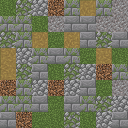

# Palette Shuffle

Random block placement from your hotbar, with an adjustable chance for each slot. Put the blocks of your palette in your hotbar, turn on shuffle mode, and every block you place switches your hotbar to a random block. Walls, floors and paths get a natural mix without switching slots by hand.

A Fabric mod for Minecraft 26.3. It runs only on the client, so it works without being installed on the server.

## Features

- **Shuffle mode:** press **K** to turn it on or off. When you turn it on, and after every block you place, your hotbar switches to a random slot holding a block. Tools, other items and empty slots are skipped, and the same block can come up twice in a row.
- **Slot highlight:** while shuffle mode is on, the slots it can pick are highlighted in green.
- **Chances per slot:** press **J** to open the settings.
  - **Automatic:** every slot holding a block is equally likely, so two slots of red wool and one of white wool place red twice as often.
  - **Manual:** choose which slots take part and give each one a weight from 0 to 999. Red wool with weight 2 and white wool with weight 1 gives the same mix as above.
- **Chance labels:** if the slots aren't all equally likely, each one shows its chance right above the hotbar.
- **Mod Menu:** with [Mod Menu](https://modrinth.com/mod/modmenu) installed, the settings also open from its Configure button.

Both keys can be changed under Options → Controls → Key Binds → Palette Shuffle. The settings are saved in `config/paletteshuffle.json`.

## Requirements

- Minecraft 26.3
- Fabric Loader 0.19.3 or newer
- [Fabric API](https://modrinth.com/mod/fabric-api)
- Optional: [Mod Menu](https://modrinth.com/mod/modmenu)

## Building

You need Java 25.

```bash
./gradlew build
```

The mod jar is written to `build/libs/PaletteShuffle-1.0.jar`. `./gradlew runClient` starts a development client with Mod Menu, and `./gradlew runClientGameTest` runs the in-game tests.

## License

Copyright © 2026 Jarne Rolf. All rights reserved, see [LICENSE.txt](LICENSE.txt). You're welcome to read the code here, but the license doesn't allow you to reuse, modify or redistribute it.

The icon is an in-game screenshot of Minecraft's cobblestone, mossy cobblestone, stone bricks, mossy stone bricks, coarse dirt, grass block, gravel and dirt path blocks. Their textures belong to Mojang and aren't covered by this project's license.

NOT AN OFFICIAL MINECRAFT PRODUCT. NOT APPROVED BY OR ASSOCIATED WITH MOJANG OR MICROSOFT.
